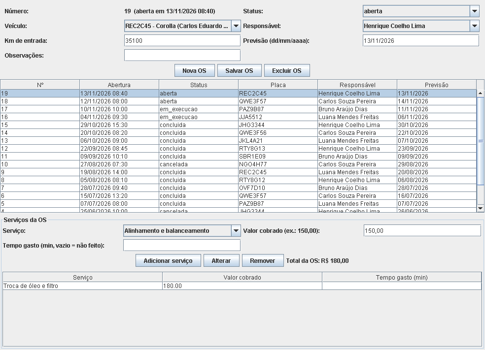
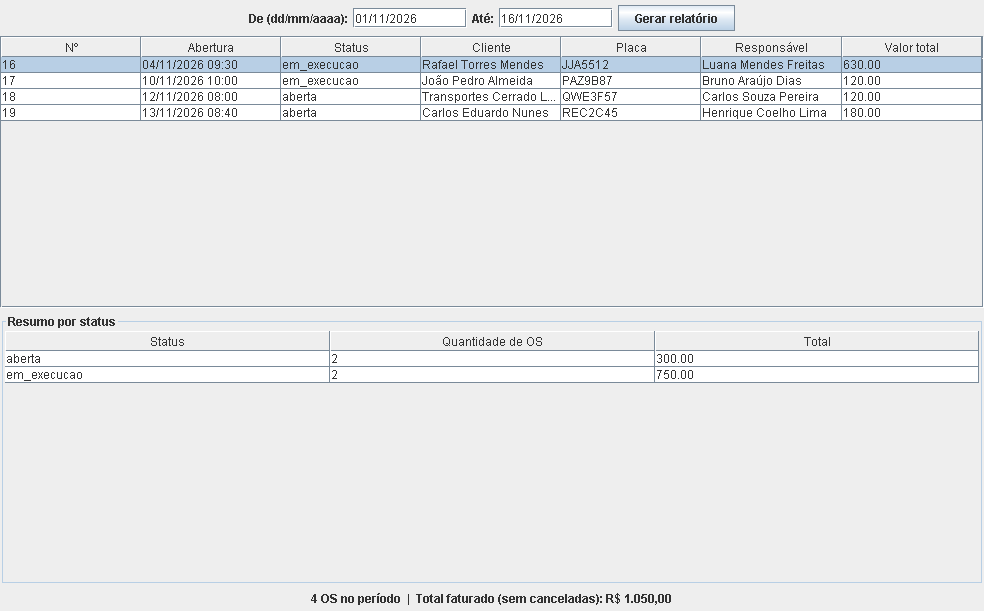

# Oficina POO

Sistema de oficina mecânica que a gente fez em grupo pro trabalho de POO na UCB. É Java com Swing nas telas e MySQL no banco, separado em model, DAO, controller e view (MVC).

O repositório original do grupo é o [FelipeCMartins0/oficina-poo](https://github.com/FelipeCMartins0/oficina-poo).

## O que dá pra fazer

- cadastrar clientes, veículos, funcionários e serviços
- abrir ordem de serviço, colocar os serviços feitos nela e acompanhar o status (aberta, em execução, concluída ou cancelada)
- consultar as OS filtrando por status, já com cliente, veículo e responsável (JOIN de 4 tabelas)
- tirar um relatório por período com o total faturado, sem contar as canceladas

## Como rodar

O jeito mais fácil é baixar o [oficina-apresentacao.zip](https://github.com/BarrinDev/oficina-poo/releases/latest/download/oficina-apresentacao.zip), descompactar e dar dois cliques no `1-criar-banco.bat` e depois no `2-abrir-sistema.bat`. Só precisa ter MySQL 8 e Java 11 ou mais novo, sem NetBeans.

Pra rodar pelo código, precisa de Java 17 ou mais novo e MySQL 8.

1. No MySQL, roda o `sql/01_ddl.sql` e depois o `sql/02_carga.sql`. O 01 apaga e recria o banco `ucb_turbo2` e cria o usuário `oficina_app` que o sistema usa. O 02 coloca os dados de exemplo. No Workbench, usa o raio (executar tudo), porque o Ctrl+Enter só roda a linha onde o cursor está.
2. Abre a pasta `oficina` no NetBeans e roda com F6. É projeto Maven, então ele baixa o driver do MySQL sozinho.

Se o teu MySQL não estiver em `localhost:3306`, é só mudar a URL em `dao/Conexao.java`. As consultas do relatório também estão soltas em `sql/03_consultas.sql`.

## Organização

- `model`: as classes com os dados (Cliente, Veiculo, OrdemServico...)
- `dao`: o SQL, sempre com PreparedStatement
- `controller`: as regras e validações. A tela não decide nada, só chama o controller
- `view`: as telas em Swing, começando pelo `MenuPrincipal`
